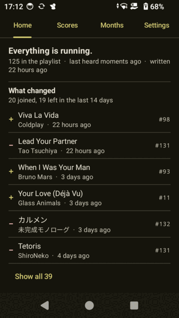
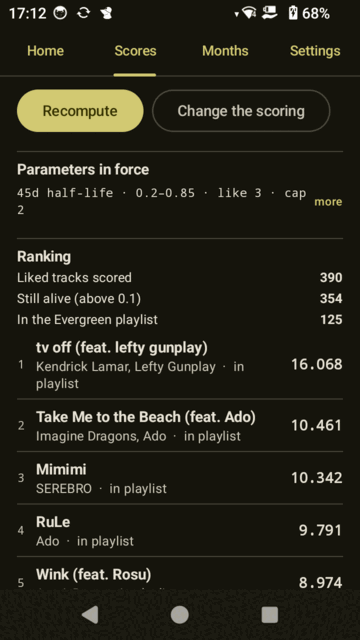
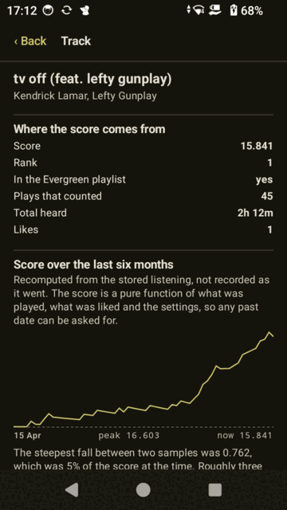
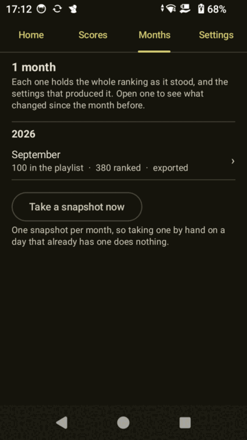

# Evergreen

An Android app that keeps a liked-songs playlist alive.

Spotify's Liked Songs only ever grows. Songs I loved two years ago and haven't
played since sit next to what I'm listening to this week. Evergreen watches what
I actually play, scores every liked song, and keeps a Spotify playlist of the
ones that are still in rotation. Songs I stop playing, or keep skipping, drop
out of it. Nothing is lost: every like stays in an archive, and each month the
ranking is saved as a snapshot I can browse later ("2026 September").

I built it for myself, to run on a Sony NW-A307 Walkman and a Pixel 10 Pro.
It is not on any app store and isn't meant to be a product.

<p>
  
  
  
  
</p>

<sub>Screenshots from the Walkman, running against my own library. Left to right:
home, ranking, one song's score over time, monthly snapshots.</sub>

## How it works

1. **Capture.** A notification-listener service reads Android media sessions and
   records each continuous listen as a *segment*: which track, how many
   milliseconds were really heard, where playback ended, why it ended. It
   handles the awkward cases: seeking, replays, repeat-one loops, pauses, and
   Spotify Connect playback. It only looks at Spotify; every other app's
   session is dropped before any of its data is read.
2. **Store.** Everything goes into a local Room (SQLite) database. Tracks have
   one canonical row plus one row per streaming service ID, so a second service
   can be added later. Likes are an append-only event log plus a current-state
   table. I also imported my Spotify extended streaming history (about 77,000
   plays since 2020), which seeds the scores and was used to calibrate them.
3. **Score.** A hand-written formula, not a trained model. A listen counts for
   or against a song depending on how much of it was heard (under 20% is a
   rejection, over 85% is a full play, partial credit in between). Credit fades
   with a 45-day half-life, a new like starts with a head start, and one song
   can only earn so much in a day so that repeat-one overnight doesn't dominate.
   Scores are recomputed from the stored facts every time, never accumulated,
   so changing a setting re-ranks everything and can be undone exactly. All the
   numbers are editable in the app.
4. **Sync to Spotify.** A song joins the playlist at rank 100 and only leaves
   below rank 130. The gap stops songs near the cutoff bouncing in and out on
   alternate days. The playlist is written at most once a day through a
   WorkManager job, and the app only ever touches a playlist it created.
5. **Snapshots.** Once a month the full ranking and the settings that produced
   it are saved, so an old month can be read back and compared with the one
   before.
6. **Two devices.** The Walkman is where I listen, the Pixel is where it's easy
   to read the stats. Facts move between them as a documented text format
   rather than a copied database. See [`docs/SYNC_FORMAT.md`](docs/SYNC_FORMAT.md).

## Where it stands

Working and in daily use on the Walkman: capture, Spotify login and like sync,
scoring, the daily playlist write, monthly snapshots, history import, backup and
restore, and cross-device sync in one direction (Walkman to Pixel).

In progress on branch `phase5c-merge`: both devices capturing and merging, one
device at a time holding the right to write the playlist. This is held back
until a capture bug is properly fixed (a Spotify Connect remote can make the
phone record phantom listens for music playing elsewhere). That investigation is
written up in [`docs/PLAN.md`](docs/PLAN.md) under "Phase 5c".

Not started: a second streaming service, desktop capture on Linux/Windows, a
self-hosted sync server. The full roadmap is in [`docs/PLAN.md`](docs/PLAN.md).

## About the AI involved

Most of the code was written by an AI coding assistant, and most commits carry
its co-author line. I started this project new to software development, so I
treated it as a way to learn by building something I wanted to use, and to see
how far one person can direct an AI through a real, multi-month project.

The split, as honestly as I can put it: the AI wrote nearly all of the code and
did much of the how-do-I-do-this research. I decided what to build, reviewed
what came back, and pushed back when it was wrong.

- **Design decisions.** I caught choices I thought were bad and proposed
  alternatives. Two principles that shaped the whole data model came from me:
  capture only records facts and never decides anything (so scoring can be
  changed later and recomputed over the same history), and no behaviour is
  designed from an assumption until it has been measured. Several times the
  measurement contradicted what we both expected, and the docs record that.
- **Product decisions.** What "alive" means for a song, which devices matter,
  what to cut (a home-screen like widget, for example), and when something was
  good enough.
- **Real-world testing.** Everything was run on a Walkman and a Pixel with my own
  listening, including calibrating the scoring against six years of my history.
- **Process.** I set the rules the AI worked under in
  [`CLAUDE.md`](CLAUDE.md): small steps, a plan I approve before any large
  change, and privacy rules that don't bend.

What that does not mean:

- **The code has not had a security review.** I put effort into the obvious
  things (below) and wrote tests for them, but nobody qualified has audited it,
  and I wouldn't ask anyone else to trust it with their account.
- **The code is not guaranteed clean.** It was written quickly and in volume.
  Comments are often longer than they should be, some files are large, and
  there will be duplication and abstractions that don't earn their keep.
- **It has had a small test audience**: me, on two devices, plus a lot of
  automated tests. Expect rough edges.

[`docs/`](docs/README.md) keeps the working record: the plan, the prompts I
gave the AI for each phase, and the findings, including the mistakes.

## Privacy and security choices

- Only `com.spotify.music` media sessions are processed. Anything else is
  discarded immediately and never stored or logged.
- Only playback facts are stored: track, artist, album, durations, timestamps,
  app package and a random device ID. No location, contacts or message content.
- No analytics, ads or crash-reporting SDKs. The only network traffic is to
  Spotify's API.
- Spotify login uses Authorization Code with PKCE, so there is no client secret
  in the app. Tokens are encrypted with a non-extractable Android Keystore key
  and live outside the database. The app asks for the minimum scopes
  (`user-library-read`, `playlist-read-private`, `playlist-modify-private`) and
  creates playlists as private.
- The database and tokens are excluded from Android cloud backup and device
  transfer.
- A formula decides the playlist, not a machine-learning model. Spotify's
  developer terms don't allow training on its data, so this is deliberate.

## Building it yourself

Spotify's development mode limits an app to a handful of allowlisted users and
requires the app owner to have Premium, so you have to register your own app.

1. Create an app at [developer.spotify.com](https://developer.spotify.com/dashboard).
   Add the redirect URI `com.example.evergreen://auth` and add your own account
   under User Management.
2. Put your client ID in `local.properties` (gitignored):
   `spotify.clientId=YOUR_CLIENT_ID`
3. Build and install. Gradle needs `JAVA_HOME` pointing at a JDK; Android
   Studio's bundled one works:
   ```
   JAVA_HOME=/opt/android-studio/jbr ./gradlew :app:installDebug
   ```
4. On the device, grant notification access to Evergreen when the app asks.

Requires Android 12 (API 31) or newer.

**Tests**

```
./gradlew :app:testDebugUnitTest            # 278 unit tests, no device needed
./gradlew :app:connectedDebugAndroidTest    # 251 instrumented tests
```

Don't run the instrumented tests on a device whose listening history you care
about. Android uninstalls the app afterwards, which deletes its database.

## Code layout

```
app/src/main/java/com/example/evergreen/
  capture/    media-session listener, segment tracking, position estimation
  data/       Room database, DAOs, backup/restore, sync batch export/import
  scoring/    decay, ranking, playlist membership rules, snapshots (pure Kotlin)
  spotify/    PKCE login, encrypted token store, API client, like and playlist sync
  history/    importer for Spotify's extended streaming history export
  ui/         Jetpack Compose screens
```

Built with Kotlin, Jetpack Compose, Room, WorkManager and coroutines. The
`scoring/` package has no Android dependencies, so all of it is covered by plain
JVM tests.

## Docs

[`docs/README.md`](docs/README.md) explains what's in `docs/`. The two you'd
want first are [`docs/PLAN.md`](docs/PLAN.md) (roadmap, status, findings) and
[`docs/SYNC_FORMAT.md`](docs/SYNC_FORMAT.md) (the cross-device format).

## License

None yet. Until one is added, all rights are reserved.
